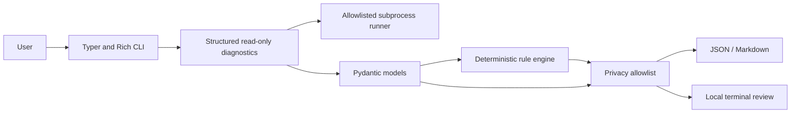

# FastVPS Doctor — engineering demonstration package

**Independent contribution; not an official FastVPS product.** All demonstration data below is simulated and clearly labeled. It must not be presented as a real FastVPS customer or VPS result.

## Slide 1 — Product overview

FastVPS Doctor is a local-first Linux CLI for collecting guest-OS evidence and creating privacy-conscious reports. It is intended for beginners and VPS customers who need a clearer starting point before troubleshooting or opening a support request.

## Slide 2 — Product boundary

- FastVPS publicly describes 24/7 infrastructure monitoring and offers public DNS/email, SSL/website and browser latency tools.
- FastVPS Doctor checks selected guest-level state from inside Linux.
- It does not replace provider monitoring, reproduce public DNS/TLS checks, or decide responsibility under a service plan.

## Slide 3 — Architecture

## Slide 4 — Feature summary

- CPU/memory/load/uptime and Linux pressure indicators.
- Root filesystem capacity, inode pressure and read-only mount flag.
- Local route/resolver state; one user-approved DNS lookup or TCP destination when explicitly requested.
- Selected common service states and read-only Nginx/Apache/SSH validators.
- Limited SSH/UFW observations and loopback web reachability.
- Deterministic findings, confidence and limitations.
- JSON/Markdown local reports with explicit metric allowlists.

## Slide 5 — Demonstration scenario (simulated)

1. Show the normal `fastvps-doctor diagnose` command from a disposable Linux container.
2. In a separate unit-test fixture, feed the rule engine a simulated root filesystem at 96% usage and show the `STOR-001` explanation.
3. Generate a Markdown support report from that fixture.
4. Point out that the example fixture is not production telemetry and that real reports must be reviewed.

Example fixture: [simulated report](examples/simulated-report.md).

## Slide 6 — Security and privacy

- Read-only by default, no root required for normal use, no automatic repair or upload.
- Fixed allowlisted commands, no shell, timeouts and small output limits.
- Raw logs and configuration text are omitted; only failed detected services get a bounded, summarized recent-journal scan.
- Reports exclude hostnames, IP addresses, usernames and paths by default.
- Local report review remains the user's responsibility.

## Slide 7 — Quality and test coverage

Current review result on Windows with Python 3.13.7: 60 tests passed and the two opt-in Linux integration tests were skipped. Ruff lint/format, mypy, and the source/wheel build passed. A disposable Ubuntu integration job is configured in GitHub Actions but has not yet run, so these results do not verify Linux compatibility.

## Slide 8 — Known limitations

- No Linux integration execution has occurred in the current Windows development environment.
- Narrow set of services/security settings; service logs are intentionally not collected.
- Root filesystem and IPv4 route focus; partial inventory possible without privileges.
- No history, log correlation, backup verification, dashboard or FastVPS integration.

## Slide 9 — Future roadmap

1. Run the configured disposable Ubuntu integration job and record its actual result; test Debian images separately before claiming Debian compatibility.
2. Improve structured failure evidence and distribution-specific adapters.
3. Expand tests and security review of report fields and command behavior.
4. Consider historical comparisons or log correlation only after privacy/scope review.
5. Consider any FastVPS integration only with documented authorization.

## Setup for a live demonstration

Use an isolated disposable Ubuntu/Debian VM or the provided integration Dockerfile. Build a separate simulated fixture through unit tests for failure examples. Do not induce resource exhaustion or stop real services to create a demo effect. The sample report is synthetic.

