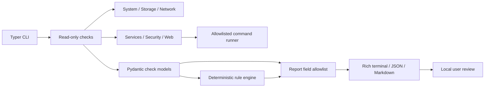

# Architecture and implementation plan

## Architecture proposal

Keep the command layer thin. Diagnostic modules return Pydantic `DiagnosticCheck` objects, the deterministic rule engine converts those checks into `Finding` objects, and the report layer applies privacy allowlists before rendering. The allowlisted command runner is the only subprocess boundary. Platform-specific reads live next to the diagnostic that owns them; external networking happens only for explicit user-supplied one-destination checks.



## Initial directory structure

```text
src/fastvps_doctor/
  checks/                 focused read-only diagnostic modules
  cli.py                  Typer commands and Rich rendering
  config.py               validated local thresholds
  models.py               shared structured check, finding and report models
  platform.py             sanitized Linux distribution identification
  privacy.py              report allowlists and text bounds
  reports.py              JSON and Markdown generation
  rules.py                deterministic explanations and classification
  runner.py               centralized subprocess allowlist and timeouts
tests/                     unit and opt-in Linux integration tests
docs/                      operator, privacy, architecture and testing guides
```

## Staged implementation checklist

- [x] Phase 1 — Repository inspection, FastVPS scope review, architecture, risks and staged plan.
- [x] Phase 2 — Packaging, Typer CLI foundation, shared models, local thresholds and initial system checks.
- [ ] Phase 3 — Initial storage/network/service/security/web checks are implemented; broad mounted-filesystem coverage, provider-independent firewall checks and TLS inspection remain incomplete.
- [x] Phase 4 — Initial deterministic rules with evidence, confidence, thresholds and cautious recommendations.
- [x] Phase 5 — JSON/Markdown report foundation, field allowlists, optional ticket reference and FastVPS context.
- [ ] Phase 6 — Unit tests, CI, Ruff and mypy are configured; Linux integration and broader failure/platform validation remain to be run.
- [x] Phase 7 — Documentation, proposal, simulated report, demonstration package and letter.
- [ ] Follow-up — Execute Linux integration in Ubuntu and Debian containers/VMs and revise from operator feedback.
- [ ] Follow-up — Add broader platform adapters and more tests before calling the tool production-ready.

The checked boxes indicate that an initial deliverable exists; they do not mean every requested diagnostic is complete. Consult `docs/LIMITATIONS.md` for scope gaps and the delivery summary for checks actually executed.

## Threat and risk assessment

| Risk | Design response | Remaining limitation |
| --- | --- | --- |
| Diagnostics accidentally modify a server | Commands are fixed and read-only; no repair verbs are implemented | Third-party tools invoked by an allowlisted command are outside this project's control |
| Shell injection | No shell is used; executable and argument forms are centralized and fixed | New command support must retain strict argument validation |
| Secrets leak into support reports | Allowlisted metrics, bounded text scrubbing, no raw logs/config content, and no destination hostnames | Text scrubbing is not a general DLP guarantee; every new report field/rule still needs privacy review |
| Checks consume resources or hang | Short timeouts; fixed, small probes; no recursive directory walks | psutil behavior and OS subprocesses vary by distro; Linux integration is needed |
| A finding overstates certainty | Evidence, confidence and limitations are explicit; CPU spikes alone are not findings | Rules are a small heuristic set, not a full incident-response system |
| Missing permission looks like health | Checks can be skipped or unknown and state the limitation | Some operating systems expose partial process/network inventory without root |
| Responsibility is attributed to the hosting provider | FastVPS profile uses undetermined scope where evidence cannot separate guest and infrastructure causes | Plan scope and provider-side telemetry cannot be read by this tool |
| False confidence from an incomplete checklist | Reports explicitly state that “no major findings” is not proof of health or security | Coverage remains narrow and local |
| Reports are shared without review | Report command writes locally only; docs and report header ask users to review | The tool cannot control what a user later shares |

## Extension contract

1. Add a read-only check module returning `DiagnosticCheck` data. Do not print from checks.
2. Add only needed metrics to the explicit per-check allowlist in `privacy.py`.
3. Add deterministic rule tests for healthy, failing and inconclusive evidence.
4. Keep descriptions, possible causes and recommendations scoped to observed evidence.
5. Document required privileges, supported platforms, timeouts and privacy behavior.

