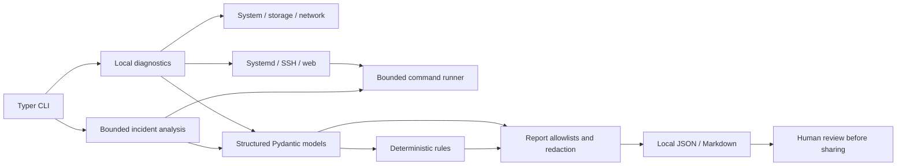

# Architecture and implementation plan

## Data flow

The CLI coordinates focused local checks. Checks return structured models, deterministic rules convert only allowlisted observations into findings, and the report builder applies export allowlists before JSON or Markdown rendering. Subprocess access is centralized in `runner.py`.



## Modules

```text
src/fastvps_doctor/
  checks/                 focused system, storage, network, service, security and web checks
  cli.py                  Typer commands and Rich output
  config.py               validated local thresholds
  incident_analysis.py    bounded timestamped journal classification and correlation
  models.py               check, finding, incident and versioned report schemas
  platform.py             restricted Linux distribution identification
  privacy.py              metric allowlists, field bounds and common-pattern redaction
  reports.py              local JSON/Markdown generation and exclusive file creation
  rules.py                deterministic explanations and confidence
  runner.py               fixed commands, arguments, timeouts and output bounds
tests/                     unit fixtures and opt-in disposable Linux integration tests
docs/                       operator, safety, compatibility and evaluation guidance
examples/                   synthetic report and demo reproductions
```

## Safety and evidence contracts

1. Run with ordinary privileges. A permission failure is unavailable evidence, not a reason to escalate.
2. Use fixed executables and argument vectors; never interpolate input into shell syntax.
3. Bound elapsed time, output bytes, journal records and time windows.
4. Keep external DNS/TCP checks opt-in and limited to one explicitly named destination.
5. Keep custom service names validated and only inspect user-selected units.
6. Never export raw logs or configuration contents. Add new report fields only after explicit privacy review and regression coverage.
7. Derive findings from observed metrics; state alternatives and uncertainty; never turn absent evidence into a secure/default assumption.
8. Make report creation exclusive and keep sharing a human decision.

## Scope and known design choices

- Storage uses `statvfs` available counters so reserved filesystem resources contribute to user pressure. Per-mount inspection is capped, skips unsupported/remote/symlinked/inaccessible paths and never exports mount paths.
- Route observations cover active IPv4 and IPv6 default routes. Policy routing, custom network namespaces and provider routing remain outside the check.
- Service state uses bounded `systemctl show` properties rather than executable presence alone. Common aliases are deduplicated; custom units require explicit selection.
- SSH review uses `sshd -T`. A complete optional connection context is required for contextual `Match` rules; without it, the report does not claim per-user effective policy.
- Incident analysis calls `journalctl` for a single validated service plus a bounded kernel event window. It accepts only structured timestamped records, maps known phrases to static event summaries, and drops original message text before report construction.
- Memory pressure uses Linux PSI where available. Swap use only corroborates low-available-memory observations; it does not independently create a finding.
- Reports use schema version 2.0. The existing CLI is retained and strict automation exit codes are opt-in to avoid changing default command behavior.

## Validation status

The 11 October 2026 QA run passed 134 tests on Windows 11/Python 3.13.7 (two Linux-only integration tests skipped) and 136 tests on WSL Ubuntu 26.04/Python 3.14.4 (including the opted-in Linux integration tests). Linux statement coverage was 92.5% and branch-inclusive coverage was 90%. Linux Ruff, formatting, mypy, pip consistency, source installation, and rebuilt-wheel console entry point passed. Real WSL diagnostics, JSON/Markdown report creation, mode 0600, systemd inspection, and comparisons with native storage/memory/route utilities were exercised. GitHub Actions is configured for Ubuntu unit jobs and disposable Ubuntu 24.04/Debian 12/Debian 13 integration images, but those jobs have not run. Docker was unavailable, so the local Ubuntu 24.04/Debian matrix was not run; the sponsored Ubuntu 24.04.5 VPS was not accessed. This does not establish compatibility with that VPS or production readiness. See [testing](TESTING.md), [limitations](LIMITATIONS.md), [the complete QA report](COMPLETE_QA_REPORT.md) and [release readiness](RELEASE_READINESS.md).

## Remaining implementation and validation stages

- [x] Audit the original implementation and record evidence-backed risks.
- [x] Harden service states, effective SSH inspection, storage and report privacy.
- [x] Add bounded incident analysis, versioned support handoff and strict exit option.
- [x] Add mocked failure fixtures, test-backed synthetic demos and Ubuntu/Debian CI configuration.
- [x] Run source and wheel integration in WSL Ubuntu 26.04; add real unprivileged Linux smoke evidence.
- [ ] Run GitHub CI and the Ubuntu 24.04/Debian 12/Debian 13 matrix; fix any distro-specific failures.
- [ ] Perform the safe unprivileged smoke test on the sponsored VPS, only after the user verifies OS/Python and chooses to do so.
- [ ] Request engineering feedback on the report, unit coverage and management-scope wording.

## Threat and risk assessment

| Risk | Design response | Remaining limitation |
| --- | --- | --- |
| Diagnostics change a production server | No repair operations or automatic privilege escalation | Third-party behavior and Linux integration remain to be tested |
| Shell injection | No shell; validated host/unit inputs and fixed command forms | New commands still require review |
| Private data enters a report | Explicit check allowlist, no raw logs, bounded text redaction, private file creation | Pattern redaction is not universal; review each export |
| Check hangs or consumes resources | Timeouts, output caps, bounded journal reads and no recursive scans | Kernel/process behavior differs between distributions |
| Finding claims too much | Deterministic rules with evidence, confidence and alternatives | Small heuristic rule set; no root-cause proof |
| Missing permissions looks like health | Unknown/skipped states are preserved and summarized | Some host views are intentionally unavailable to normal users |
| Provider responsibility is misassigned | Guest evidence only; report scope remains unknown where appropriate | Plan agreement and provider-side telemetry are not accessible |
| Incomplete testing creates false confidence | Windows and Linux evidence are explicitly separated | CI and live-host validation still need actual results |
